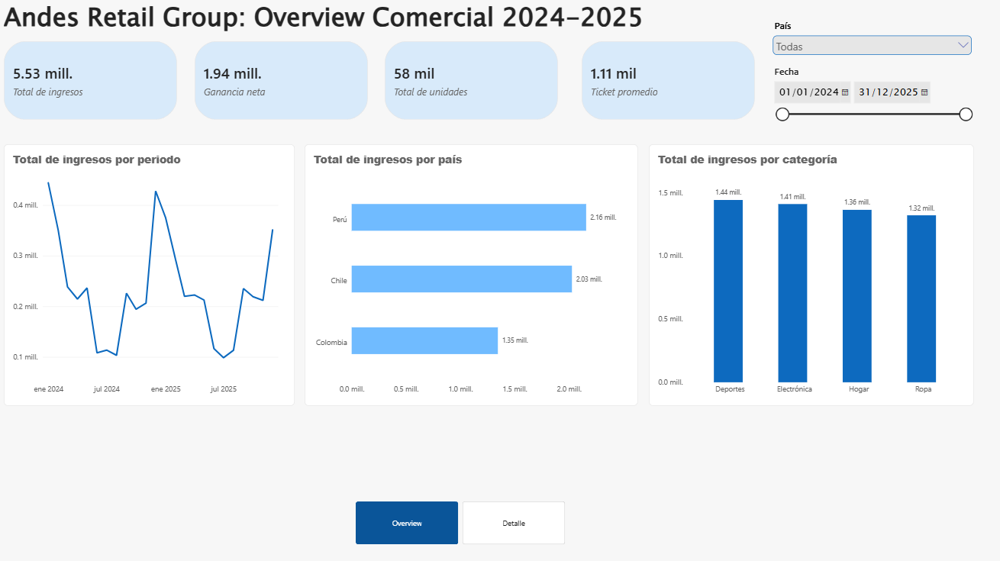
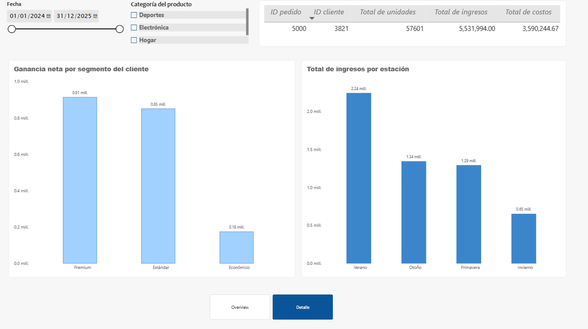

# 📊 Dashboard de Desempeño Comercial — Andes Retail Group (2024–2025)

## 🎯 Objetivo del Proyecto
Diseñar un dashboard ejecutivo e interactivo en **Power BI** para evaluar el desempeño comercial de **Andes Retail Group** durante el periodo 2024–2025 en Perú, Chile y Colombia, facilitando la toma de decisiones estratégicas sobre rentabilidad, desempeño por categoría y estacionalidad.

**Objetivos particulares:**
* Consolidar y monitorear los KPIs clave de ingresos, ganancia neta, volumen de unidades vendidas y ticket promedio por mercado y categoría.
* Identificar los segmentos de clientes más rentables y cuantificar el impacto estacional en las ventas para proponer acciones concretas de fidelización y mitigación.

---

## 🖼️ Vistas del Dashboard

### 1. Vista Overview (Desempeño General)
Monitoreo ejecutivo de KPIs principales, tendencia temporal de ingresos, comparativo geográfico y distribución por categoría de producto, con filtros interactivos por **País** y **Fecha**.

### 2. Vista Detalle (Rentabilidad y Estacionalidad)
Desglose transaccional por pedidos, clientes únicos, ingresos y costos, junto con el análisis de ganancia neta por segmento de cliente y comportamiento de ingresos por estación del año.

---

## 🛠️ Preparación de Datos y Modelado (Power Query & Power BI)
* **Limpieza y tipificación:** Se cargó el dataset en memoria, se estandarizó el formato de `Fecha_pedido` a fecha corta (`dd/mm/aaaa`) y se corrigieron los tipos de datos de columnas numéricas.
  
* **Ingeniería de variables:** Se creó la columna condicional `Nivel_Venta` basada en `Ingresos` (`>= 1000` → `"Venta Alta"`, de lo contrario → `"Venta Baja"`).
  
* **Validación de calidad:** Se auditó la integridad del dataset mediante la herramienta **Vista Perfil de Columna** en Power Query.
  
* **Diseño UX/UI:** Arquitectura en dos páginas con botones de navegación (`Overview` y `Detalle`), jerarquía visual de lectura en Z y segmentadores dinámicos.

---

## 💡 Hallazgos Clave (Modelo SCQA)
* **Volumen y rentabilidad consolidada:** Durante 2024–2025 se registraron **5,000 pedidos** de **3,821 clientes únicos**, generando **$5.53M en ingresos** ($5,531,994.00), **$1.94M en ganancia neta**, **57,601 unidades vendidas** y un **ticket promedio de $1.11K**.
  
* **Liderazgo geográfico y equilibrio de portafolio:** **Perú ($2.16M)** y **Chile ($2.03M)** concentran la mayor parte de la operación frente a **Colombia ($1.35M)**. Las cuatro categorías mantienen un desempeño muy balanceado, lideradas ligeramente por **Deportes ($1.44M)** y **Electrónica ($1.41M)**.
  
* **Rentabilidad por segmento de cliente:** El segmento **Premium** es el principal motor de ganancia neta (**$0.91M**), seguido muy de cerca por **Estándar ($0.85M)**, mientras que **Económico** aporta **$0.18M**.
* **Fuerte dependencia estacional:** Las ventas alcanzan su punto máximo en **Verano ($2.24M)** y sufren una contracción crítica en **Invierno ($0.65M)**, con **Otoño ($1.34M)** y **Primavera ($1.29M)** en niveles intermedios.

---

## 📌 Recomendaciones de Negocio
1. **Fidelización del segmento Premium:** Concentrar esfuerzos de retención y marketing en el nicho más rentable ($0.91M en ganancia neta) para blindar el margen operativo.
   
2. **Mitigación de la caída invernal:** Diseñar estrategias promocionales agresivas y *bundles* en las categorías de **Deportes** y **Electrónica** enfocados específicamente en contrarrestar la contracción de ventas proyectada para el invierno.

---

## 📂 Estructura del Repositorio
* `andes_retail_desempeno_comercial.ipynb`: Documentación completa del proceso ETL, diseño visual, narrativa SCQA y comunicación ejecutiva para Slack.
* `andes_retail_dashboard_2024_2025.pbix`: Archivo interactivo de Power BI Desktop *(o enlace en la documentación)*.
* `dashboard_overview.png` / `dashboard_detalle.png`: Capturas de alta resolución de ambas vistas del reporte.

## 🚀 Cómo explorar el proyecto
1. Clona este repositorio: git clone https://github.com/ricardomc41-3006/andes_retail_dashboard_powerbi.git
